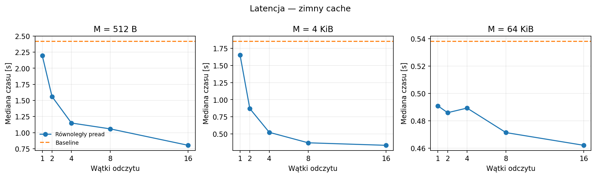
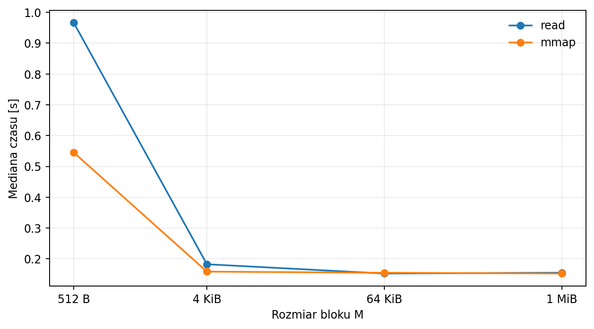
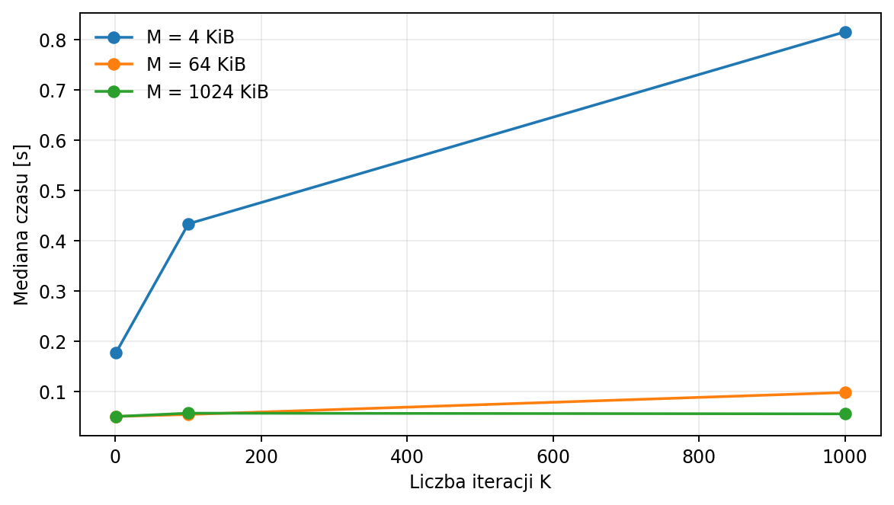
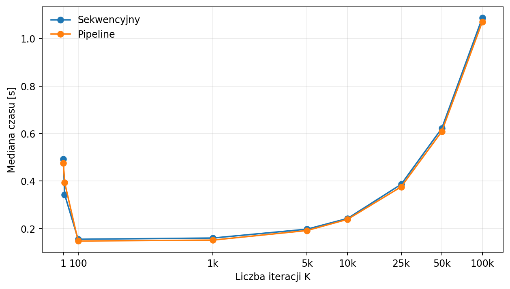

# Raport

Na wykresach podano mediany czasów wykonania. Badano pliki 100 MiB (główne pomiary) i 32 MiB (różne M i K w pipeline). Wersje bazowe i poprawione dawały zgodne wyniki.

## 1. Latencja - losowy odczyt

Przy zimnym cache zwiększanie liczby wątków wyraźnie skracało czas wykonania: dla M = 4 KiB z **1,651 s** (1 wątek odczytujący) do **0,334 s** (16 wątków). Wątki mogą nakładać oczekiwanie na operacje I/O. Przy ciepłym cache efekt jest mniejszy, a dla M = 512 B dodatkowe wątki nawet spowalniały program (0,250 s dla 1 wątku i 0,406 s dla 16) z powodu narzutu synchronizacji i kanału.

Więcej wątków nie oznacza mniejszej latencji pojedynczego `pread()` - może jedynie skrócić łączny czas realizacji wielu odczytów. Tego pierwszego nie mierzono bezpośrednio. File cache ogranicza potrzebę odczytu z dysku: dla bazowego programu i M = 4 KiB czas wynosił **0,174 s** przy ciepłym cache i **1,853 s** przy zimnym.

## 2. Przepustowość - `mmap()`

Największą korzyść z `mmap()` otrzymano dla **M = 512 B**: czas spadł z **0,966 s** (`read`) do **0,545 s** (`mmap`) przy ciepłym cache. Przy 64 KiB różnica praktycznie znika (0,152 s i 0,155 s). Powodem jest duża liczba wywołań `read()` dla małych bloków. Przy takim schemacie `mmap()` może też zmniejszać czas CPU w jądrze, choć obsługa stron pamięci nadal kosztuje.

Przy zimnym cache dla M = 64 KiB czasy obu implementacji wzrosły do około **0,24 s**. Cache poprawia więc wydajność obu sposobów odczytu. Są to pomiary czasu całego programu, a nie opóźnienia pojedynczego dostępu do danych.

## 3. Pipelining - przeplot I/O i obliczeń

Dla małych bloków zwiększenie K mocno wydłuża czas działania, ponieważ trzeba obliczyć dużo więcej skrótów. Dla M = 1 MiB wpływ K do 1000 był mały: po pierwszym MD5 na bloku kolejne iteracje przetwarzają już tylko 16-bajtowy skrót. Pipeline zwykle nieznacznie przyspieszał wykonanie, choć dla małych bloków zysk zmniejsza narzut komunikacji między wątkami.

Dla **M = 1 MiB** i pliku 100 MiB przy ciepłym cache wzrost czasu staje się wyraźny przy K rzędu kilku tysięcy; dokładnego **K_opt** nie udało się ustalić przez niestabilność pomiarów przy małych K. Dla zimnego cache wyniki były jeszcze bardziej zmienne: zauważalny wzrost występował od około **K = 25 000**, ale nie pozwala to wiarygodnie wyznaczyć K_opt. Co ważne, opróżnienie cache przed pomiarem pliku 100 MiB nie zapewnia ciągłego odczytu z dysku, więc dla takiego scenariusza brak miarodajnego wyznaczenia K_opt.

Więcej wątków odczytujących może pomóc, gdy ograniczeniem jest I/O. Dodatkowe wątki hashujące mogą przyspieszać obliczenia różnych bloków, gdy ograniczeniem jest CPU, jeśli ogranicza nas dysk, nie przyniosą dużej poprawy.
